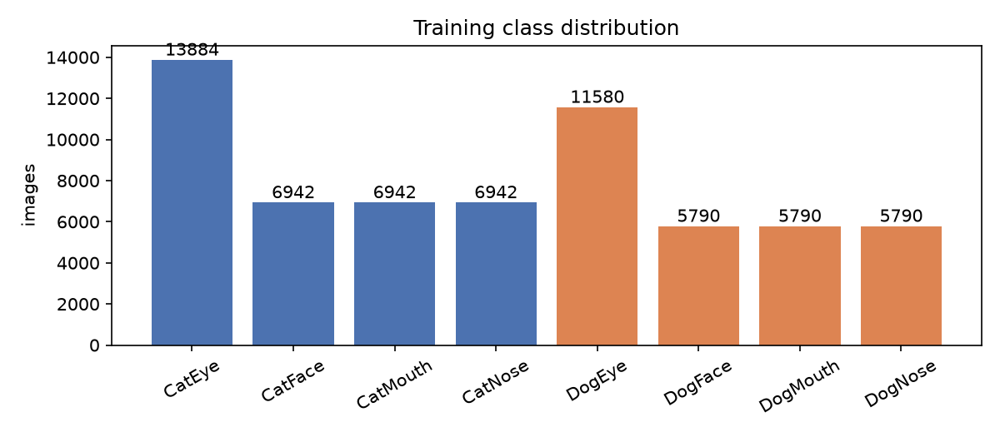
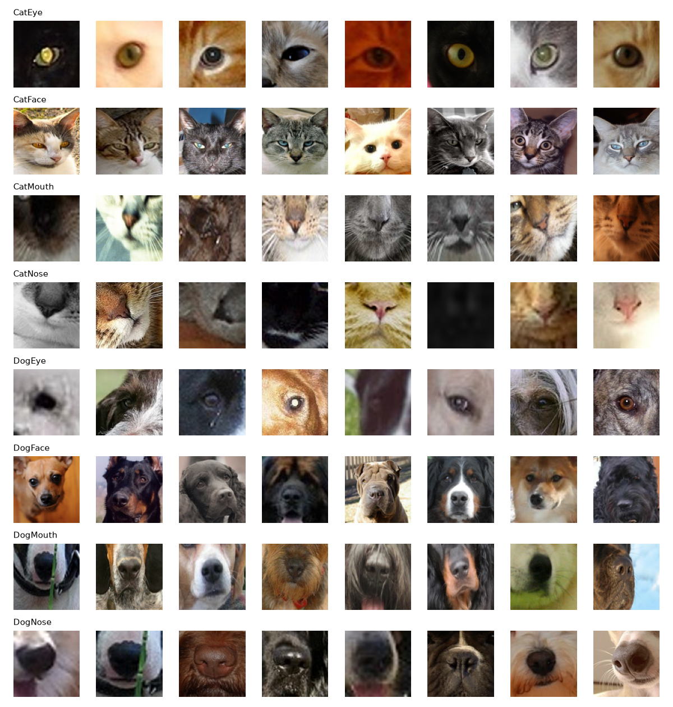
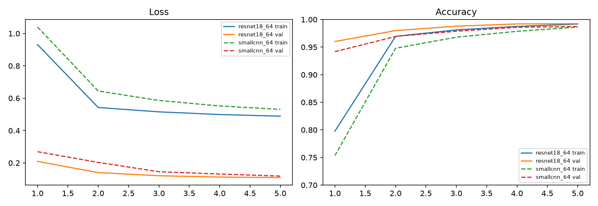
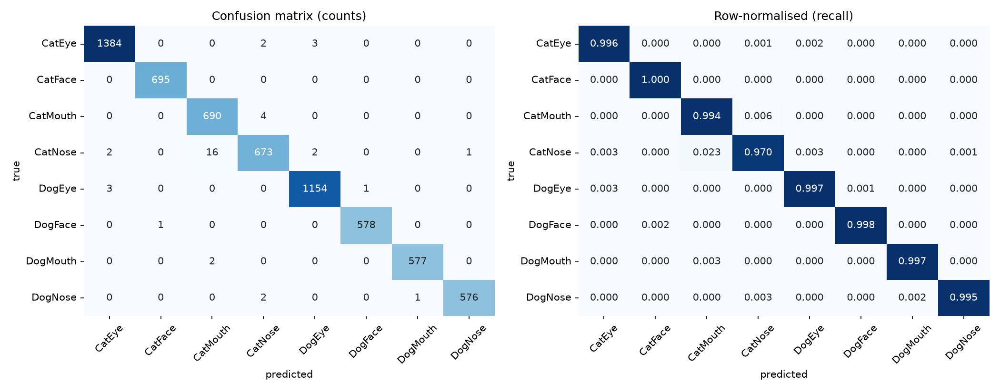
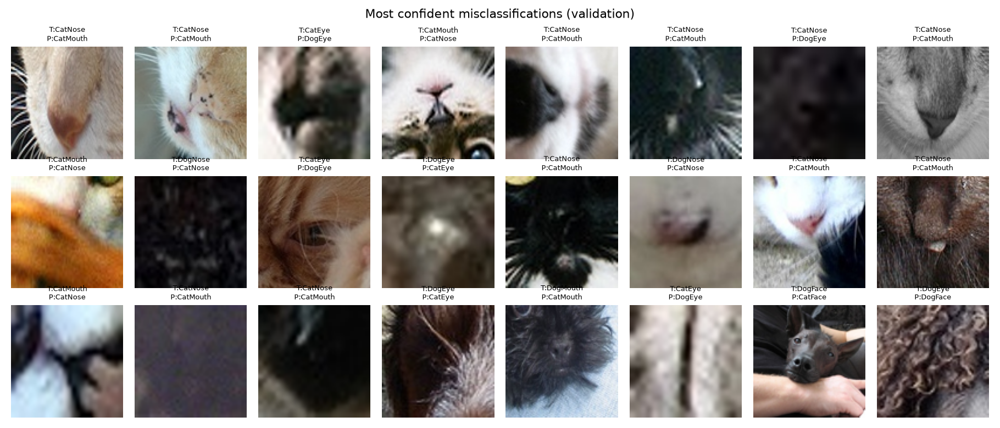

# Facial Feature Classification of Cat and Dog Images with a Fine-Tuned ResNet-18

**ENGE707 – Assessment 3** | Student: [YOUR NAME] | Student ID: [YOUR ID] | Kaggle username: [YOUR KAGGLE USERNAME]
GitHub repository: https://github.com/nimishmaharaj27-dotcom/Nimish-kaggle-comp

## 1. Introduction

This report describes an end-to-end deep learning pipeline for the ENGE707 Kaggle competition "Facial Feature Classification Challenge". Each image shows one facial feature of a cat or a dog, and the task is to assign it to one of eight classes: CatEye, CatFace, CatMouth, CatNose, DogEye, DogFace, DogMouth or DogNose. The problem combines two decisions: which species is shown and which facial region is shown. It is therefore a coarse-grained recognition task, but a messy one, because the crops are small, vary in quality and in places overlap in content.

I worked independently on every stage: data exploration, preprocessing, model selection, training, validation, submission, evaluation and critical analysis. The central design decision was driven by a practical constraint. I had no GPU and trained on a 16-core laptop CPU, so the image resolution, model size and number of epochs had to be chosen so that every experiment finished in under an hour. I used a pretrained ResNet-18 fine-tuned end to end on 64×64 inputs, and compared it with a small convolutional network trained from scratch. The pretrained model reached 99.25% validation accuracy (99.37% with flip test-time augmentation), against 98.73% (98.92%) for the baseline. The Kaggle leaderboard score of the final submission was [ADD KAGGLE SCORE], which I compare with the validation figure in Section 6.

## 2. Dataset Exploration and Understanding

**Structure.** The competition provides 63,660 labelled training images (`train/train/*.jpg` with `train_labels.csv`) and 29,443 unlabelled test images (`test/test/*.jpg`). A `sample_submission.csv` lists the 29,443 test identifiers. One detail needs care: test files are zero-padded on disk (`00001.jpg`) while the submission file uses plain integers (`1`), so the identifier must be converted when loading. All images are three-channel JPEGs.

**Class distribution.** Figure 1 shows the training labels. The two Eye classes are twice as large as the others: CatEye has 13,884 images and DogEye 11,580, whereas CatFace, CatMouth and CatNose have 6,942 each and DogFace, DogMouth and DogNose 5,790 each. The data are therefore imbalanced, but in a structured way. Within each species the three non-eye classes are perfectly balanced and the eye class is exactly double, presumably because each animal contributes a left and a right eye. The largest class holds 21.8% of the data and the smallest 9.1%, a ratio of 2.4:1 overall. I did not use resampling or class weights, but I report per-class precision, recall and F1 because accuracy alone can hide weakness in smaller classes.

**Sample images.** Figure 2 displays eight random examples per class. Eye and Face crops are visually distinctive. Mouth and Nose crops, in contrast, look very similar within a species: the "mouth" crops of both cats and dogs are mostly a close-up of the muzzle that includes the nose, and some "nose" crops include whiskers and lips. This is the clearest example of an unclear class boundary in the data, and it shaped the later error analysis.

**Image sizes.** The source crops are not standardised. Side lengths range from 4 to 2,219 pixels in the training set and from 8 to 1,978 pixels in the test set. About 34% of training images are non-square, and size is strongly associated with class: faces are the largest (mean about 190–250 px per side), eyes and noses the smallest (about 75–80 px) and mouth crops are wide rectangles (mean about 130×93 px). In total 1,290 training images (2.0%) and 648 test images (2.2%) have a side shorter than 24 pixels, so they contain very little detail. Interestingly, 67% of test images are non-square compared with 34% of training images. The class mix I later predict for the test set is close to the training mix, so this does not look like a simple change in class proportions; it may indicate a difference in how the test crops were produced. I cannot verify this without test labels, so I treat it as a possible distribution shift and revisit it in Section 6.

**Quality issues.** I hashed every file with MD5. There are 15 duplicated files inside the training set (none with conflicting labels) and 62 inside the test set, and no test file is an exact copy of a training file, so there is no test-to-train leakage through identical files. I keep the training duplicates together when splitting (Section 3). I estimated sharpness on a random sample of 6,000 training images using the variance of a Laplacian filter: the median is about 388 while the sharpest 5% boundary sits at about 16, so a meaningful minority of images are very blurry or nearly featureless. I found no corrupted files; all images decoded successfully.

**How the data are used.** The labelled data are split into a training portion and a held-out validation portion. The model is trained on the training portion only, model selection and early stopping use the validation portion, and the test images are used solely to produce the Kaggle submission.

## 3. Data Preprocessing and Pipeline Preparation

**Resizing and caching.** The network needs a fixed input size. Because the source images are small and frequently under 100 pixels, a large input would only interpolate detail that does not exist, and it would make CPU training too slow. I decoded every training and test image once, converted it to RGB, resized it to 96×96 with bicubic interpolation and stored it as a `uint8` array. At training time the batch is area-downscaled to 64×64 (the resolution actually used). Caching removes JPEG decoding from the training loop and guarantees every run reads the same pixels. The resize ignores the original aspect ratio, so non-square mouth crops are stretched. I accepted this because the stretch is applied identically to every image in every split and the network can still recognise the stretched appearance, but it does discard the aspect-ratio signal that, as Section 2 showed, is correlated with class. Preserving it (for example by padding to a square) is listed as a possible improvement.

**Normalisation.** Pixel values are divided by 255 and standardised with the ImageNet channel means (0.485, 0.456, 0.406) and standard deviations (0.229, 0.224, 0.225). The same constants are used for training, validation and test images. These match the statistics the pretrained model was trained with.

**Label encoding.** The eight class names are mapped to integers in alphabetical order (CatEye = 0, …, DogNose = 7), and the integer-to-name mapping is used again to write the submission.

**Train/validation split.** I held out 10% of the labelled data (6,367 images) for validation, leaving 57,293 for training. The split is stratified by class, so each class keeps the same proportion in both parts, and grouped by file hash, so identical images cannot appear on both sides. I used scikit-learn's `StratifiedGroupKFold` with ten folds and took the first fold, with a fixed random seed of 42. A single split keeps each experiment cheap on a CPU; at 99% accuracy a validation set of this size has a standard error of roughly 0.1 percentage points (see limitations).

**Augmentation.** Training batches are augmented on the fly with: random horizontal flip (probability 0.5), rotation of up to ±15°, scaling between 0.85 and 1.15, translation of up to ±10% (with reflection padding), and random brightness (±0.15) and contrast (×0.85–1.15) changes. These transformations mimic realistic variation in animal pose, camera framing and lighting. I deliberately excluded vertical flips and large rotations, because animal faces are almost never photographed upside down, and strong geometric distortion could blur the distinction between Mouth and Nose crops. Validation and test images are never augmented.

**Efficient loading.** The cached arrays (about 1.8 GB) stay in memory; each batch is converted to a tensor, augmented in one batched affine operation and passed to the network in channels-last format, avoiding a multi-process data loader.

**Avoiding leakage.** Leakage was controlled in three ways. The split was made before any model fitting and is grouped by file hash. Normalisation uses fixed constants rather than statistics computed from the data, so no information flows from validation or test images into training. And the test images pass through exactly the same deterministic resizing and normalisation as the validation images, with no augmentation.

## 4. Model Selection and Pipeline Development

**Choice of architecture.** I considered three options: a custom CNN, a pretrained CNN fine-tuned end to end, and a Vision Transformer. Vision Transformers typically need large datasets or heavy pretraining and are slow on a CPU. A pretrained CNN brings useful low-level and mid-level features (edges, textures, fur, eyes) learned from ImageNet [1], and ImageNet contains many cat and dog images, which makes transfer learning particularly well suited here. I selected **ResNet-18** [2] for three reasons: its residual connections make fine-tuning stable, it has only about 11.2 million parameters and was among the fastest backbones in short CPU timing tests at 96×96 (similar to MobileNetV3, about twice as fast as EfficientNet-B0 and three times as fast as ResNet-50), and it is a well-understood architecture that I can explain fully. As the baseline for comparison I built a **SmallCNN** trained from scratch.

**ResNet-18 architecture.** The network starts with a 7×7 convolution with stride 2, batch normalisation, ReLU and a max pooling layer. It then applies four stages of two "basic blocks" each, with 64, 128, 256 and 512 channels. Each block contains two 3×3 convolutions with batch normalisation and a skip connection that adds the block input to its output, which lets gradients flow through the network and makes identity mappings easy to learn. The final feature map is reduced with global average pooling to a 512-dimensional vector. I replaced the original 1,000-way classifier with dropout (rate 0.2) and a linear layer with **8 outputs**, one per class. The output layer produces logits, and the softmax is applied inside the cross-entropy loss during training and explicitly at inference. The input is a 3×64×64 tensor. I used the `resnet18.a1_in1k` weights from the timm library [3, 4].

**Baseline architecture.** SmallCNN has four blocks, each consisting of two 3×3 convolutions (each followed by batch normalisation and ReLU) and a 2×2 max pooling, with widths 32, 64, 128 and 256. Global average pooling, dropout (0.3) and an 8-way linear layer follow. It has about 1.2 million parameters, roughly a tenth of ResNet-18, and is trained from random initialisation. Its purpose is to show how much benefit comes from pretraining and model size.

**Training configuration and justification.**

| Setting | Value | Reason |
|---|---|---|
| Input size | 64×64 | Source crops are small; keeps CPU epochs near 9 minutes |
| Loss | Cross-entropy, label smoothing 0.1 [5] | Multi-class problem; smoothing counters over-confidence on ambiguous Mouth/Nose labels |
| Optimiser | AdamW, weight decay 0.05 [6] | Adaptive steps suit fine-tuning; decoupled weight decay regularises |
| Learning rate | One-cycle schedule, peak 2×10⁻³, 20% warm-up, cosine decay [7] | Fast convergence in a small epoch budget; warm-up protects pretrained weights |
| Batch size | 128 | Good CPU throughput and stable gradients |
| Epochs | 5 | Validation accuracy had almost plateaued; limited by compute |
| Dropout | 0.2 (ResNet), 0.3 (SmallCNN) | Regularisation of the classifier head |
| Seed | 42 | Reproducibility |

The baseline uses a peak learning rate of 3×10⁻³ because it starts from random weights and tolerates a larger step. I did not run a hyperparameter search (a limitation); the values are standard fine-tuning defaults.

**Pipeline.** The pipeline uses PyTorch [8], timm [3] and scikit-learn [9] and is split into scripts for caching, EDA, training (split, augmentation, models, loop) and evaluation/prediction. The training loop keeps the checkpoint with the best validation accuracy and writes a per-epoch history. Prediction applies the same preprocessing to the test images, averages the softmax of each image and its horizontal flip (test-time augmentation, TTA) and writes a file in the `sample_submission.csv` format.

## 5. Training Strategy and Overfitting/Underfitting Management

**Monitoring.** After every epoch the model is evaluated on the clean validation set and I record training loss and accuracy (on the augmented batches) and validation loss and accuracy. The checkpoint with the best validation accuracy is kept, and training would stop early if validation accuracy failed to improve for four consecutive epochs, although with a five-epoch schedule that rule never triggered.

**Learning curves.** Table 1 and Figure 3 show the five epochs for both models.

| Epoch | ResNet-18 train acc | ResNet-18 val acc | ResNet-18 val loss | SmallCNN train acc | SmallCNN val acc | SmallCNN val loss |
|---|---|---|---|---|---|---|
| 1 | 0.798 | 0.960 | 0.209 | 0.754 | 0.942 | 0.269 |
| 2 | 0.970 | 0.980 | 0.140 | 0.948 | 0.969 | 0.203 |
| 3 | 0.981 | 0.988 | 0.121 | 0.968 | 0.979 | 0.146 |
| 4 | 0.988 | 0.992 | 0.113 | 0.979 | 0.986 | 0.131 |
| 5 | 0.992 | 0.9925 | 0.110 | 0.986 | 0.987 | 0.119 |

*Table 1: Per-epoch training and validation performance. Training accuracy is measured on augmented batches during the epoch.*

**Interpreting the curves.** Two features stand out. First, validation accuracy is higher than training accuracy at every epoch, and the validation loss is far below the training loss. This is the opposite of the usual over-fitting pattern and has two explanations. Training accuracy is computed on augmented images and while the weights are still changing during the epoch, while validation uses clean images and the end-of-epoch weights. In addition, the training loss includes label smoothing, which sets a floor on the achievable loss (a perfectly confident prediction still incurs a loss of roughly 0.5 for eight classes with smoothing 0.1), whereas the validation loss is the plain cross-entropy. The curves are therefore not directly comparable in level, but their trends are informative. Second, validation loss decreases monotonically for both models, with no upturn, and the gap between training and validation accuracy shrinks to under half a percentage point. I conclude there is no evidence of over-fitting within five epochs.

**Underfitting.** The relevant risk was the opposite one. The baseline's validation accuracy is still rising at epoch 5 and its training accuracy (0.986) is close to validation accuracy, which suggests a small model that has not yet saturated, not memorisation. ResNet-18 leaves less room (0.992 training, 0.9925 validation). Longer training or a larger input might help both, but compute limited the budget.

**Strategies applied and why.** I combined several generalisation measures from the start rather than adding them reactively, because each epoch costs roughly nine minutes and a trial-and-error loop was not affordable: (1) transfer learning from ImageNet, which provides strong features and is the biggest single reason ResNet-18 beats the baseline in the first epoch (0.960 vs 0.942); (2) data augmentation, to mimic natural variation and reduce dependence on exact pixel patterns; (3) weight decay and dropout, to regularise the weights and the classifier head; (4) batch normalisation, built into both architectures, which stabilises optimisation; (5) label smoothing, to avoid over-confident outputs on ambiguous Mouth/Nose crops; (6) the one-cycle learning-rate schedule, which warms up gently so the pretrained weights are not destroyed, and then decays to small values so that the final epochs fine-tune carefully; and (7) best-checkpoint selection with early stopping on validation accuracy.

**Changes made during development.** A smoke test on 6,400 images reached 89.6% validation accuracy after one epoch, confirming the pipeline worked. My first full run was planned for eight epochs but was very slow because other jobs shared the CPU. After timing a step in isolation (about 1.1 s for 128 images) I reduced the plan to five epochs per model; nothing else changed.

## 6. Model Evaluation and Kaggle Submission

**Validation results.** On the 6,367 held-out validation images, ResNet-18 achieves accuracy 0.9925 and validation loss 0.1095. With flip TTA the accuracy rises to **0.9937** (about 40 errors) and the loss to 0.1088. The baseline SmallCNN reaches 0.9873 (loss 0.1185) and 0.9892 with TTA. ResNet-18 therefore makes about half as many errors as the baseline (0.63% against 1.08% with TTA). Both models gain 0.1–0.2 points from TTA, which is cheap and does not require retraining.

**Class-level metrics.** Table 2 gives the per-class report for ResNet-18 with TTA.

| Class | Precision | Recall | F1 | Support |
|---|---|---|---|---|
| CatEye | 0.9964 | 0.9964 | 0.9964 | 1,389 |
| CatFace | 0.9986 | 1.0000 | 0.9993 | 695 |
| CatMouth | 0.9746 | 0.9942 | 0.9843 | 694 |
| CatNose | 0.9883 | 0.9697 | 0.9789 | 694 |
| DogEye | 0.9957 | 0.9965 | 0.9961 | 1,158 |
| DogFace | 0.9983 | 0.9983 | 0.9983 | 579 |
| DogMouth | 0.9983 | 0.9965 | 0.9974 | 579 |
| DogNose | 0.9983 | 0.9948 | 0.9965 | 579 |
| **Macro average** | 0.9935 | 0.9933 | **0.9934** | 6,367 |

*Table 2: Validation precision, recall and F1 for the final model (ResNet-18, 64×64, with flip TTA).*

Macro-averaged F1 (0.9934) is almost identical to accuracy, which indicates that the 2:1 imbalance is not harming the smaller classes. Seven of the eight classes have F1 above 0.995 or very close; the exception is the cat nose/mouth pair, with CatNose recall of 0.970 and CatMouth precision of 0.975. The confusion matrix in Figure 4 shows that the largest single error is 16 CatNose images predicted as CatMouth; all other off-diagonal cells contain four or fewer images.

**Submission.** I generated predictions for all 29,443 test images with the same preprocessing and flip-averaged prediction, wrote them to `submission.csv` and checked it matches the sample submission format (unique identifiers, no missing values). Eye classes make up 40% of the predictions, matching the 40% in the training data, so the predicted class mix looks plausible.

**Kaggle result.** I submitted the file through the competition's Submit Predictions page under the username [YOUR KAGGLE USERNAME]. The leaderboard score was [ADD SCORE] [public/private], and the screenshot is included as `evidence/leaderboard.png`. [WRITE ONE OR TWO SENTENCES COMPARING THIS WITH 0.9937 VALIDATION ACCURACY. If the scores are within about 0.5 points, say that validation was a reliable estimate. If the leaderboard is clearly lower, say that the test set appears harder or different, link it to the larger share of non-square test images noted in Section 2 and the many tiny and blurry crops, and note that validation images were drawn from the same distribution as training while test images may not have been.]

## 7. Results Analysis and Improvement Strategies

**What the results say.** Validation accuracy of 99.4% shows the model has learned the species and region distinctions almost completely: faces and eyes are essentially solved and the difficulty is concentrated in one pair of classes. A model with a tenth of the parameters and no pretraining still reaches 98.9%, so the task is not hard in absolute terms; ResNet-18 halves the error (about 40 errors instead of 69), most visibly in the early epochs (0.960 versus 0.942 after epoch 1).

**Misclassification analysis.** I displayed the most confidently wrong validation predictions (Figure 5). They fall into four groups. (1) Cat nose and mouth confusion, as described above: the crops of one are valid examples of the other, and the label depends on how the annotator drew the box. (2) Extremely dark or blurry images that contain almost no information, for example near-black patches labelled CatNose and predicted as DogEye. (3) Crops that are not what their label says, such as a blurred patch of orange fur or a tight crop of dark fur labelled as a nose or mouth. These are likely annotation or cropping noise and place a ceiling on achievable accuracy that no model can pass without learning the noise. (4) A few genuine failures on unusual views, such as an upside-down cat muzzle labelled CatMouth, and a dog face held in a person's arms that was predicted as CatFace.

**Why performance is limited.** The remaining 0.6% error comes from (a) Mouth/Nose label ambiguity, (b) low-information crops (about 2% of images are under 24 pixels), (c) likely label noise, (d) detail lost by downsampling to 64×64 and by discarding aspect ratio, and (e) the short schedule with no hyperparameter tuning. Since many of the hardest examples look unresolvable even to a human, I expect much of the residual error to be irreducible with these labels.

**Effectiveness of the components.** I did not run ablations, so these conclusions are partly inferential. Transfer learning had a measurable effect (head start and lower final error), but the baseline also differs in size and architecture, so the whole 0.5-point gap cannot be credited to pretraining. Label smoothing probably explains the fairly high validation loss (0.11) despite 99% accuracy. TTA gave a small, consistent gain of 0.1–0.2 points. I did not test alternatives such as aspect-preserving padding or higher resolution.

**Improvement strategies.** In order of expected value for the cost:

1. *Higher input resolution* (96 or 128 pixels) so that fine textures that separate nose from mouth are preserved; I cached 96×96 arrays for this purpose, but a 96-pixel ResNet-18 epoch would take about 20 minutes on my CPU, so I did not run it.
2. *Aspect-ratio-aware preprocessing,* either padding to a square or feeding the original width and height (or their ratio) to the classifier as an extra input, since size is strongly related to class.
3. *Longer training and hyperparameter tuning,* for example 10–15 epochs, a learning-rate sweep and tuning label smoothing and weight decay.
4. *Larger or different backbones* such as ResNet-50, EfficientNet or a small Vision Transformer, and an *ensemble* of several architectures or seeds, which usually corrects errors that are independent between models.
5. *Better validation,* for instance five-fold stratified-group cross-validation to give an uncertainty estimate and to allow the final models to be trained on all labelled data.
6. *Label-noise handling* (reviewing the highest-loss training images or using a noise-robust loss) and *stronger augmentation* such as random erasing, bearing in mind that mix-based methods could blur the Mouth/Nose boundary.

**Strengths and weaknesses of the final solution.** The solution is simple, fast to train, fully reproducible and highly accurate on validation, and the evaluation covers per-class metrics, a confusion matrix and error inspection. Its weaknesses are the lack of ablations and tuning, a single validation split and a single random seed (so small differences between models are uncertain), the fixed square resizing that discards aspect ratio, a short schedule limited by compute, and the possibility, which I could only test through the leaderboard, that the test distribution differs from training in image size and quality.

## 8. Reproducibility and Conclusion

All code is in the GitHub repository linked above. The notebook `ENGE707_Facial_Feature_Classification.ipynb` documents the pipeline and displays all results; the scripts in `src/` regenerate each stage (set `DATA_DIR` and `CACHE_DIR`, then run `cache_data.py`, `eda.py`, `run_experiments.sh` and `evaluate_predict.py --submit`). A fixed seed (42) controls the split, new-layer initialisation, shuffling and augmentation; bit-exact repeatability across library versions is not guaranteed, but results should be very close.

In conclusion, a pretrained ResNet-18 fine-tuned for five epochs on 64×64 crops classifies cat and dog facial features with 99.4% validation accuracy and a macro F1 of 0.993, clearly better than a from-scratch CNN, with errors concentrated in the cat nose/mouth pair and in low-quality or mislabelled crops. The Kaggle leaderboard result of [ADD SCORE] is the independent check of how well this validation estimate transfers to the competition test set. The most promising next steps are higher resolution, aspect-aware preprocessing, longer training with tuning and an ensemble.

## References

[1] J. Deng, W. Dong, R. Socher, L.-J. Li, K. Li and L. Fei-Fei, "ImageNet: A large-scale hierarchical image database," in *Proc. IEEE CVPR*, 2009, pp. 248–255.

[2] K. He, X. Zhang, S. Ren and J. Sun, "Deep residual learning for image recognition," in *Proc. IEEE CVPR*, 2016, pp. 770–778.

[3] R. Wightman, "PyTorch Image Models (timm)," GitHub repository, 2019. https://github.com/huggingface/pytorch-image-models

[4] R. Wightman, H. Touvron and H. Jégou, "ResNet strikes back: An improved training procedure in timm," arXiv:2110.00476, 2021.

[5] C. Szegedy, V. Vanhoucke, S. Ioffe, J. Shlens and Z. Wojna, "Rethinking the Inception architecture for computer vision," in *Proc. IEEE CVPR*, 2016, pp. 2818–2826.

[6] I. Loshchilov and F. Hutter, "Decoupled weight decay regularization," in *Proc. ICLR*, 2019.

[7] L. N. Smith and N. Topin, "Super-convergence: Very fast training of neural networks using large learning rates," arXiv:1708.07120, 2018.

[8] A. Paszke et al., "PyTorch: An imperative style, high-performance deep learning library," in *Advances in NeurIPS 32*, 2019.

[9] F. Pedregosa et al., "Scikit-learn: Machine learning in Python," *J. Machine Learning Research*, vol. 12, pp. 2825–2830, 2011.

[10] ENGE707 Kaggle Competition, "Facial Feature Classification Challenge," Kaggle, 2026 (private competition).
